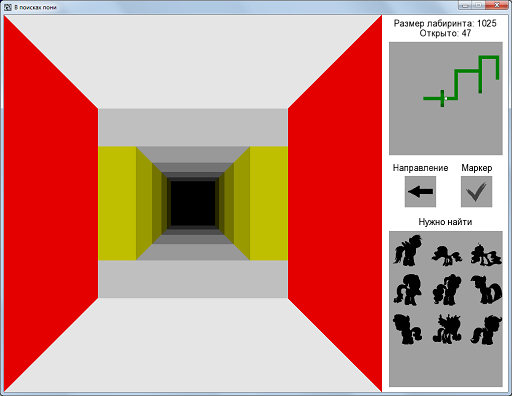
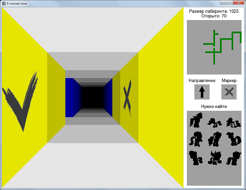
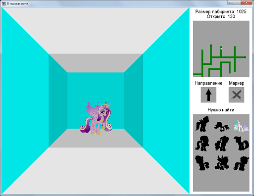
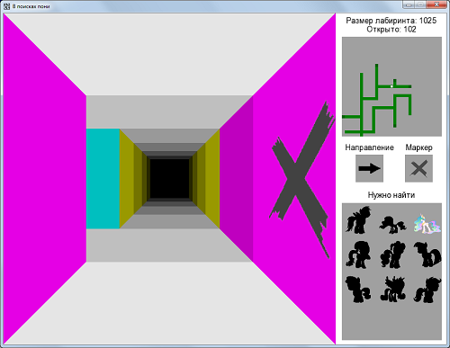

Игра "Бесконечные стены", автогенерируемый двумерный лабиринт с путешествием
по нему в псевдо-3D стиле.\
**Проект находится в разработке!**

 

 

Целью игры на данном этапе является найти всех героев, спрятанных в лабиринте.
Перемещение и отображение лабиринта выполнены в стиле псведо-3D, движение идет
только по направлениям "вперед и назад", с возможностью поворота на 90 градусов
и размещением строго по центру коридора.
Текущие возможности игры:
* Несколько размеров лабиринта на выбор
* Случайная генерация лабиринта
* Установка трех видов маркеров на стены
* Мини-карта и стрелка, указывающая направление

Более общая задача проекта - разработка модульной системы, где можно будет
скриптами создавать задачи игры и инструменты прохождения лабиринта.
